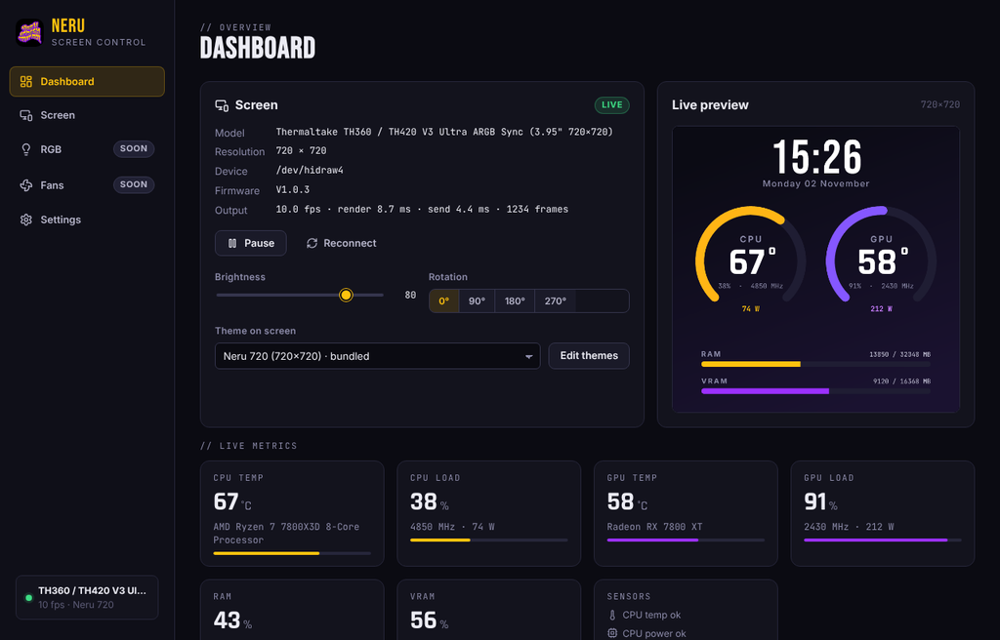
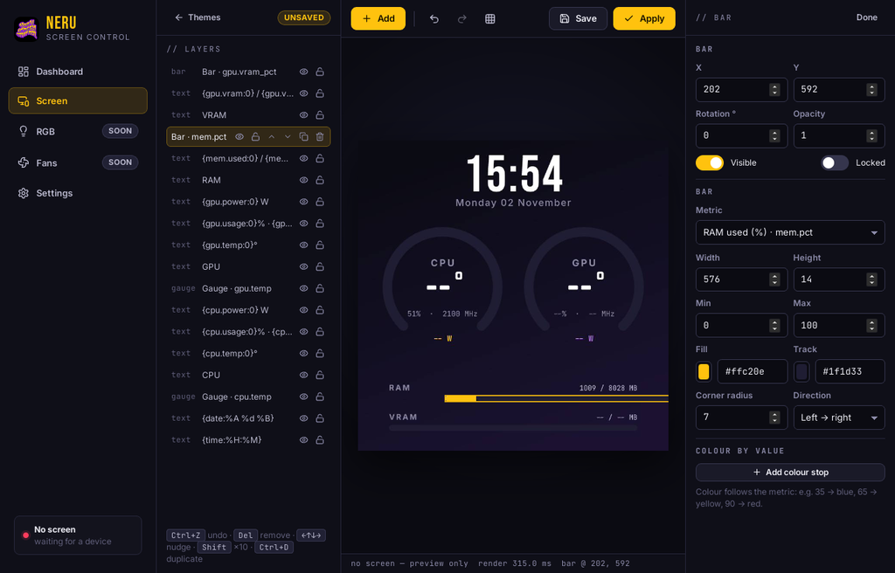
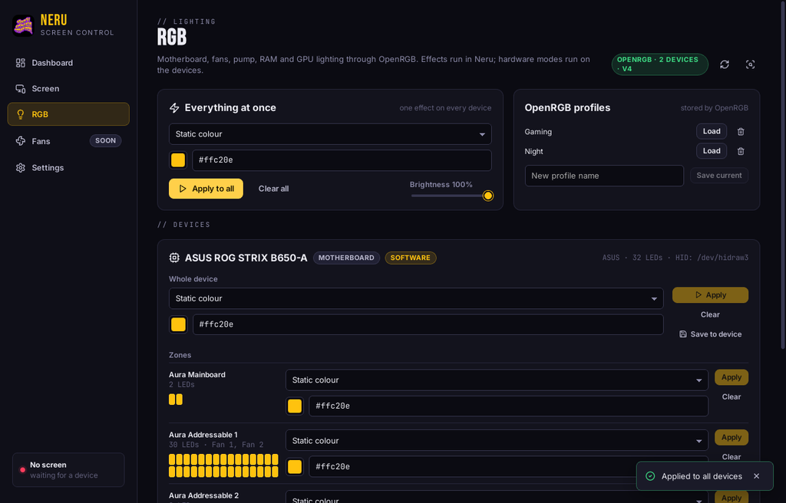
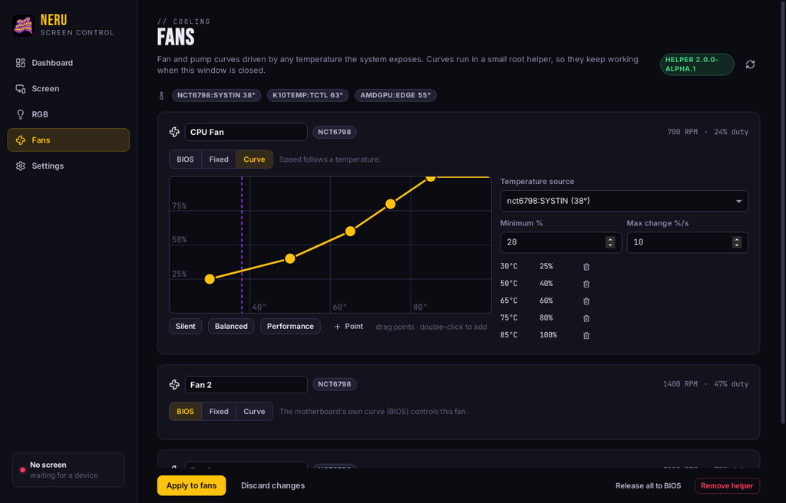

# Neru Screen Control

> Cooler LCD screens, PC RGB lighting and fan curves — one Linux app.


Neru drives the little LCD on your CPU cooler with live system metrics and your
own themes, puts every RGB device OpenRGB knows under one roof, and runs fan
curves — without Windows software, from a tray icon.



| Theme editor | RGB | Fans |
|---|---|---|
|  |  |  |

## What it does

* **Screen** — themes with text, live metric placeholders, bars, arc gauges,
  shapes, images, animated GIFs and video, rendered by Neru and streamed to the
  cooler's screen. A live editor: every change shows on the screen as you make it.
  Brightness and rotation, auto-reconnect, works headless from the tray.
* **RGB** — every device [OpenRGB](https://openrgb.org) detects (motherboard
  ARGB headers → cooler fans and pump, RAM, GPU, …). Per zone: software effects
  (static, breathing, rainbow, colour cycle, **temperature-reactive**) or the
  device's own hardware modes; OpenRGB profiles. [`docs/RGB.md`](docs/RGB.md)
* **Fans** — curves on any hwmon PWM channel from any temperature (CPU, GPU,
  NVMe, Super I/O…), applied by a small root helper that keeps working with the
  app closed and hands fans back to the BIOS when told. [`docs/FANS.md`](docs/FANS.md)
* **Metrics** — CPU temperature / load / clock / power, GPU (AMD sysfs, NVIDIA NVML),
  RAM, VRAM — no agents, no root.

## Supported screens

| Screen | USB ID | Resolution | Status |
|---|---|---|---|
| Thermaltake TH360 / TH420 **V3 Ultra ARGB Sync** (pump-head LCD) | `264a:2348` | 720×720 | verified |
| Thermaltake LCD Panel Kit 6" (View 600 TG) | `264a:2347` | 1110×540 | same protocol, untested |
| Thermalright coolers with the ChiZhu USBDISPLAY controller (Frozen Warframe class) | `87ad:70db` | 320×320 | verified (v1 driver, ported) |

Protocol notes and how to add a screen: [`docs/PROTOCOLS.md`](docs/PROTOCOLS.md).

## Install

Grab a build from [**Releases**](https://github.com/Huzzama/Neru-screen-control/releases):

| File | For |
|---|---|
| `neru-screen-control_x.y.z_amd64.AppImage` | any distro — `chmod +x`, run |
| `neru-screen-control_x.y.z_amd64.deb` | Debian, Ubuntu, Mint, Pop!_OS |
| AUR: `yay -S neru-screen-control` | Arch, CachyOS, EndeavourOS, Manjaro |

Then, once:

1. **Settings → Device access → Install rules** (asks for your password; it writes
   `/etc/udev/rules.d/70-neru-screen-control.rules`), replug the screen.
2. For RGB: install OpenRGB (`sudo pacman -S openrgb` / your distro's package).
   Neru starts its SDK server itself when needed.
3. For fans: **Fans → Install helper** (a systemd service, ~1 MB).

Optional: `ffmpeg` for video backgrounds.

## Build from source

Requirements: Rust 1.80+ (`rustup`), Node.js 20+, and the Tauri Linux libraries.

```bash
# Arch / CachyOS
sudo pacman -S --needed rustup nodejs npm base-devel pkgconf libusb webkit2gtk-4.1 gtk3 libayatana-appindicator librsvg
rustup default stable
# Debian / Ubuntu
sudo apt install build-essential curl pkg-config libusb-1.0-0-dev libwebkit2gtk-4.1-dev libgtk-3-dev libayatana-appindicator3-dev librsvg2-dev nodejs npm
curl https://sh.rustup.rs -sSf | sh

git clone https://github.com/Huzzama/Neru-screen-control.git
cd Neru-screen-control
npm install                 # UI dependencies + the Tauri CLI

npm run dev                 # the app, with hot reload of the UI
npm run build               # release bundles → target/release/bundle/{deb,appimage}/
cargo build --release -p neru-cli && ./target/release/neru --help   # the CLI only
```

Config, themes and media live in `~/.config/neru-screen-control/`.
`neru-screen-control --background` starts hidden in the tray (what the
autostart entry uses).

## The `neru` command line

Everything the app does with hardware, scriptable and handy for bug reports:

```bash
neru devices                  # screens found and whether you can open them
neru probe                    # handshake: firmware, brightness, rotation, idle timeout
neru test                     # test pattern (red top-left, green top-right, blue bottom-left, yellow bottom-right)
neru show wallpaper.png       # any image; GIFs animate
neru brightness 60 · neru rotate 90
neru metrics --watch          # CPU / GPU / RAM readings
neru theme ls                 # bundled themes
neru theme render t.json -o frame.png --fake   # one frame, no screen needed
neru theme run t.json         # live on the screen
neru fonts
neru rgb devices              # what the OpenRGB server reports
neru rgb set 0 ff0000 --zone 1
neru udev --install
```

Set `NERU_LOG=debug` for verbose logs (also for the app).

## Themes

JSON files you can write by hand (format: [`docs/THEMES.md`](docs/THEMES.md)) or
build in the editor. Placeholders such as `{cpu.temp:0}°`, `{gpu.usage}%`,
`{time:%H:%M}` pull live values; ramps colour anything by temperature. Bundled
fonts: Inter, JetBrains Mono, Bebas Neue, Rajdhani (OFL) — plus every font on your
system.

## Project layout

```
crates/neru-core   drivers (screen/), metrics/, render/ (themes), engine, rgb/, fans/, config, theme store
crates/neru-cli    the `neru` tool
crates/neru-fand   the root fan helper (systemd service)
src-tauri/         the desktop app (Tauri 2): commands, tray, background mode
ui/                the app's UI (React + TypeScript + Vite)
assets/            bundled fonts (OFL) and themes
docs/              protocols, theme format, RGB and fan guides
packaging/         udev rule, desktop entry, systemd unit, deb post-install, AUR PKGBUILD
```

## Contributing

* Another Thermaltake or Thermalright screen? Open an issue with `lsusb` and, if
  you can, a USB capture of the official software sending one frame — see *Adding
  a screen* in `docs/PROTOCOLS.md`.
* `cargo test --workspace` and `npm --prefix ui run build` must pass (CI runs both).

## Credits

* The Thermaltake "BY" protocol was recovered publicly by
  [deniswsrosa/thermaltake-6inch-lcd-linux](https://github.com/deniswsrosa/thermaltake-6inch-lcd-linux)
  and [Telinhas](https://github.com/ninjairocode/telinhas-project); Neru
  re-implements it from their notes.
* RGB hardware support comes from [OpenRGB](https://openrgb.org) (GPL-2.0, used
  over its network SDK — not linked).
* Fonts: Inter, JetBrains Mono, Bebas Neue, Rajdhani under the SIL Open Font License.

## License

MIT — see [LICENSE](LICENSE). Neru 1.x (Python) lives on in the git history and
the 1.x releases.
